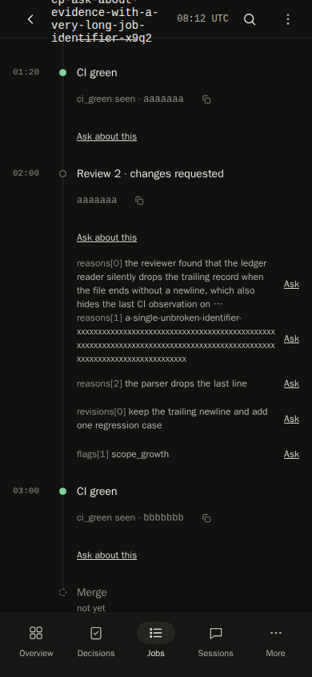
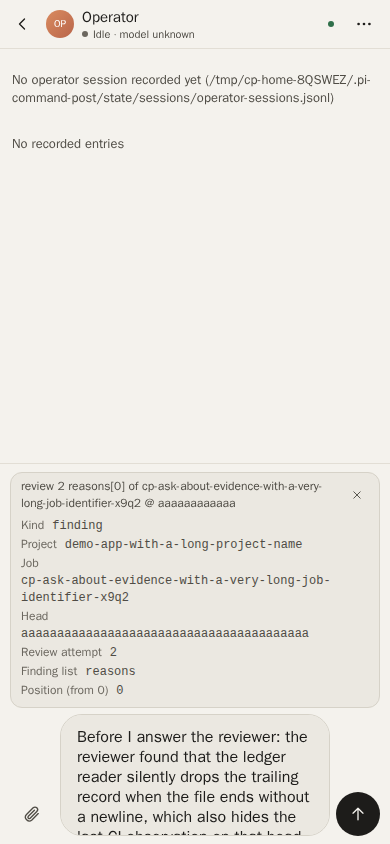

# Ask about evidence (P1 PR B) verification

The Job page timeline actions and the operator composer's reference chip (cp-p1-prb-8lan), served by a real `cp-view` in headless Chrome over CDP, at 390×844 and 1440×900.

## Fixture

A scratch home from `tests/harness/dashboard.ts` `dashboard()` (a `mktemp -d` directory, removed by the harness), plus the real dashboard-control server (`operatorSession`). No operational home, `~/.pi` or live viewer was used, and no agent ran. The capture script was a throwaway outside the repo and was not committed.

- One ledger job with a 56-character id and a 33-character project, a title that wraps.
- `review-2.json` on head A: three reasons (one longer than the 160-character cap, one unbroken 149-character identifier), one revision and the `scope_growth` flag.
- Events: a CI failure with `run_id` and `run_attempt` on A, a run-less CI green on A, the review 2 decision on A, and CI green on the current head B.

The browser cleared `localStorage`, opened `#job/<id>`, clicked the Timeline tab, then clicked the first finding's `Ask`, typed a long question and opened the chip's disclosure. Nothing was sent: the operator control recorded 0 injected messages.

## Captures

The 1440×900 captures are kept with the job's artifacts, not committed.

## Measured

| Check | 390×844 | 1440×900 |
|---|---|---|
| `scrollWidth` − viewport width | 0 | 0 |
| Timeline elements past the right edge | 0 | 0 |
| Finding rows / per-finding `Ask` | 5 / 5 (long reason clipped at 160 with `…`) | 5 / 5 |
| Ask, chip summary and Remove targets under 44 px tall | 0 | n/a (desktop) |
| Chip label | `review 2 reasons[0] of <id> @ aaaaaaaaaaaa` | same |
| Typed text kept beside the chip | yes | yes |
