# M3 slice 1: dark-only palette and compact chat transcript verification

The dark-only palette of `new-design-picp-2026-11-01.html` (cp-zm9f, slice 1 of 4) on the operator chat and the eight
other screens, captured with the browser preference set to **light**: every screen shows the same dark palette.

## Fixture

`node --experimental-strip-types tests/fixtures/sessions-chat-v2-browser.ts --stage m3-transcript --out <dir>`, run
with `<dir>` outside the repository. It builds the app in memory, serves the chat from synthetic APIs and the other
screens from the real viewer's routes on a `mktemp -d` scratch home, and drives `/usr/bin/google-chrome` headless over
CDP with a `mktemp -d` profile; both directories are removed on exit. No operational home, `~/.pi` or live viewer was
used, no agent ran and no credential was read. The stage captures 1440×1000 and 390×844 under both the dark and the
light preference (38 PNGs) and fails unless every capture's `--background` is `#0d0d0d` with `color-scheme: dark`;
the run passed with no POST and no unexpected route. Only the light-preference captures are committed here.

## Captures

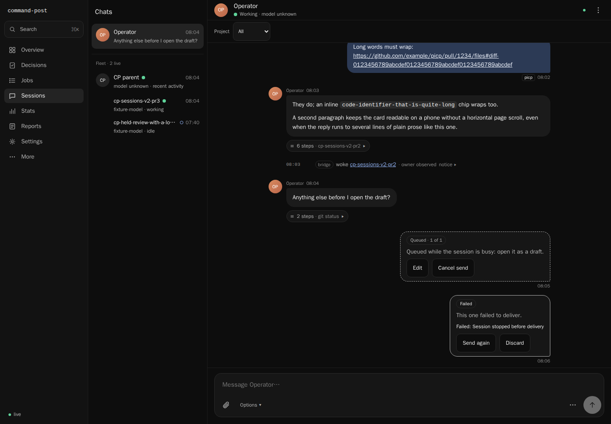

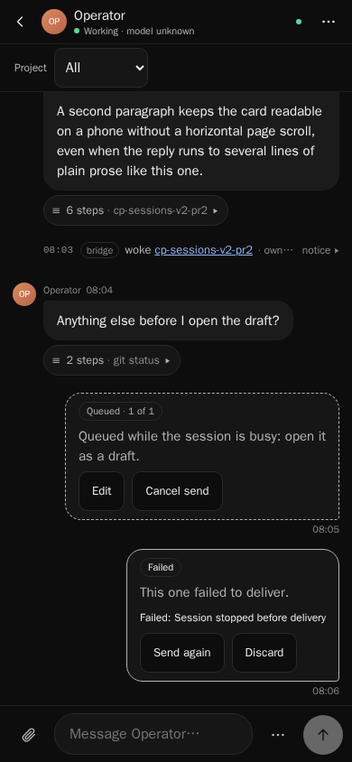

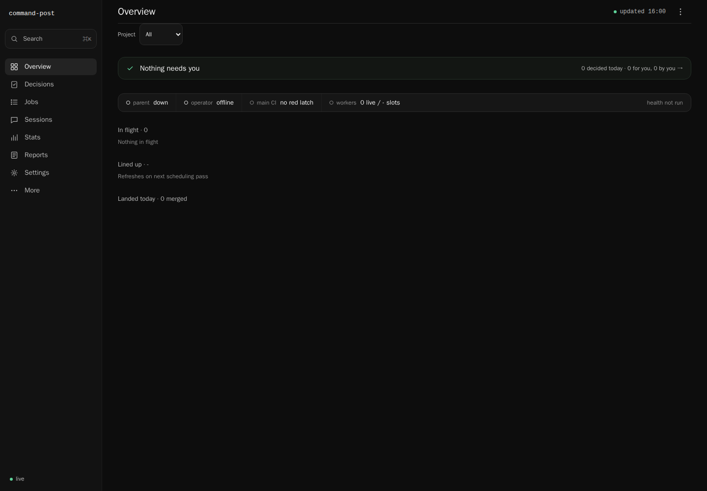 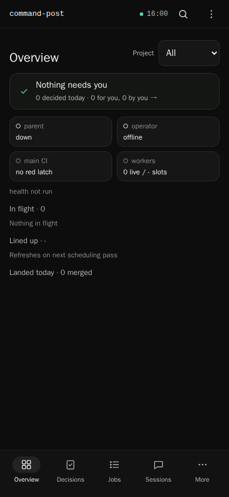

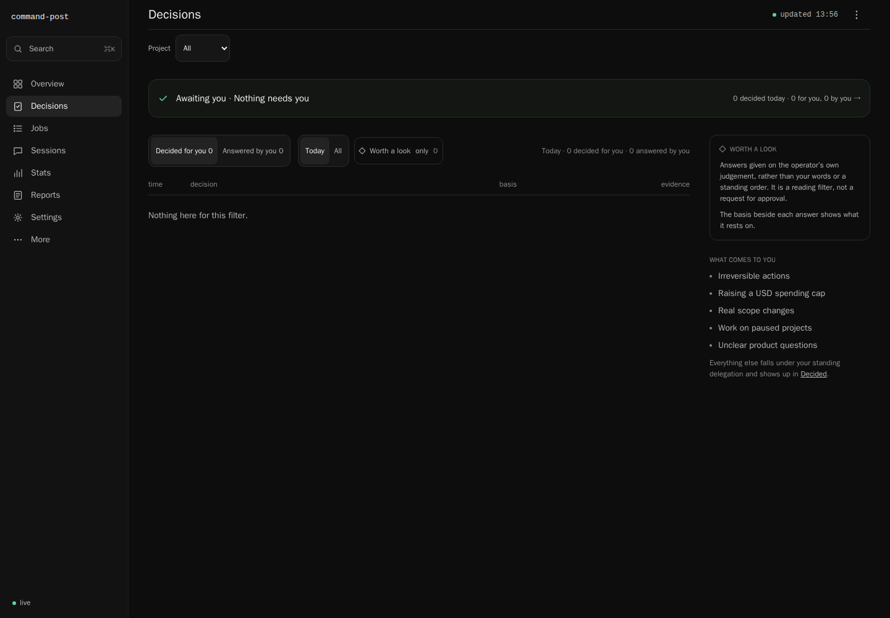 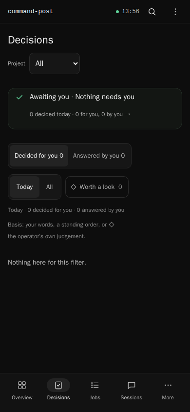

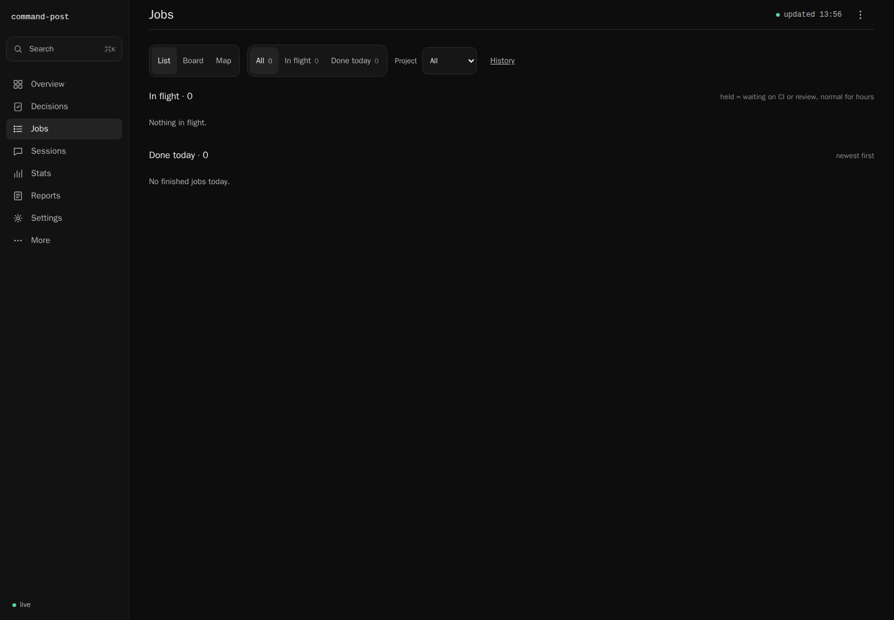 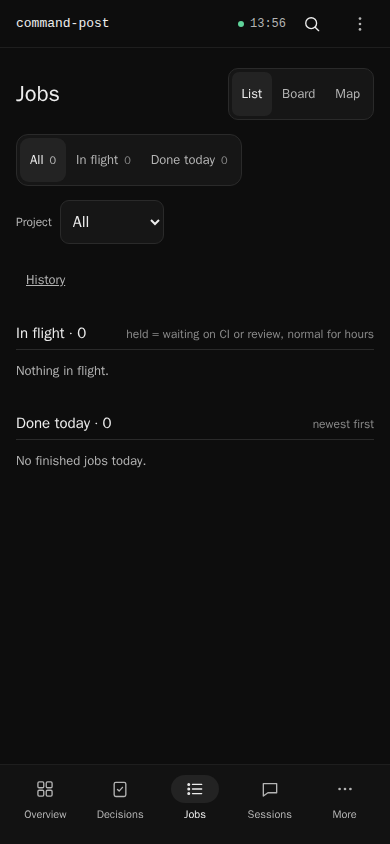

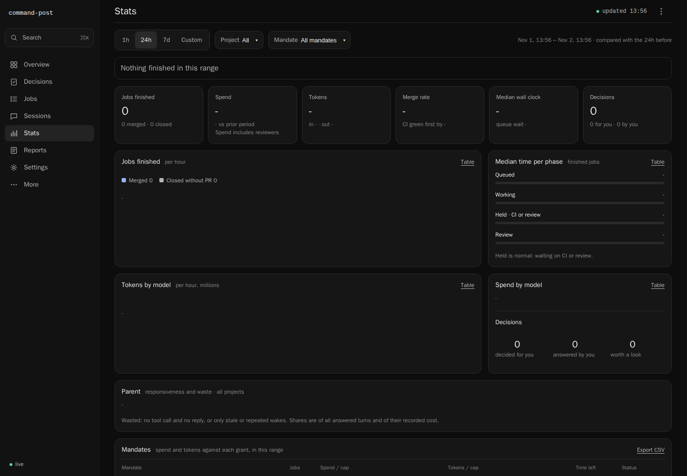 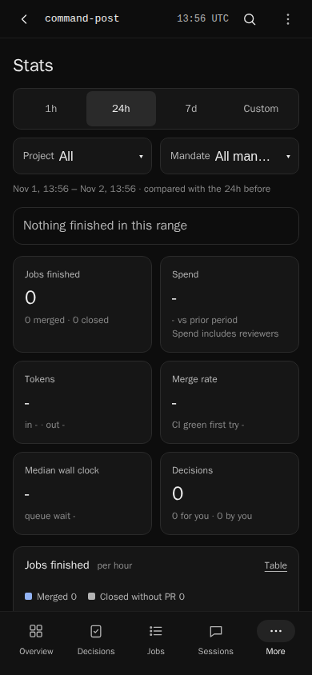

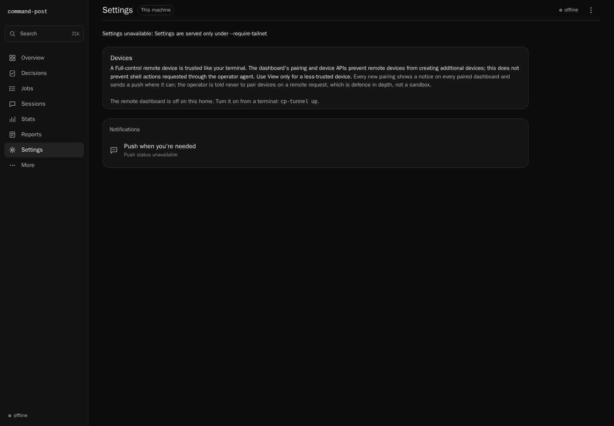 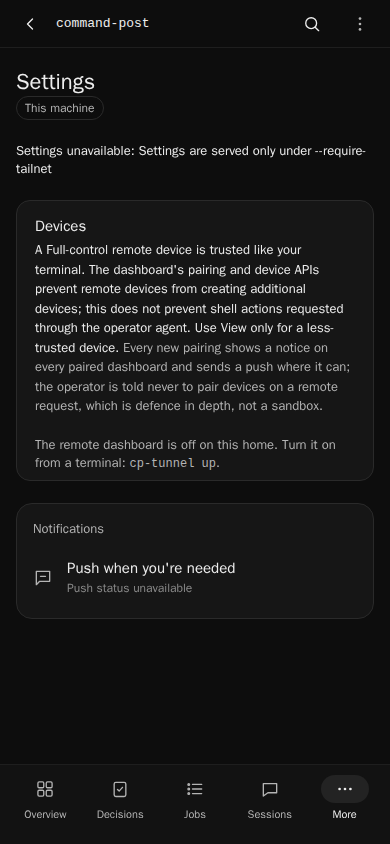

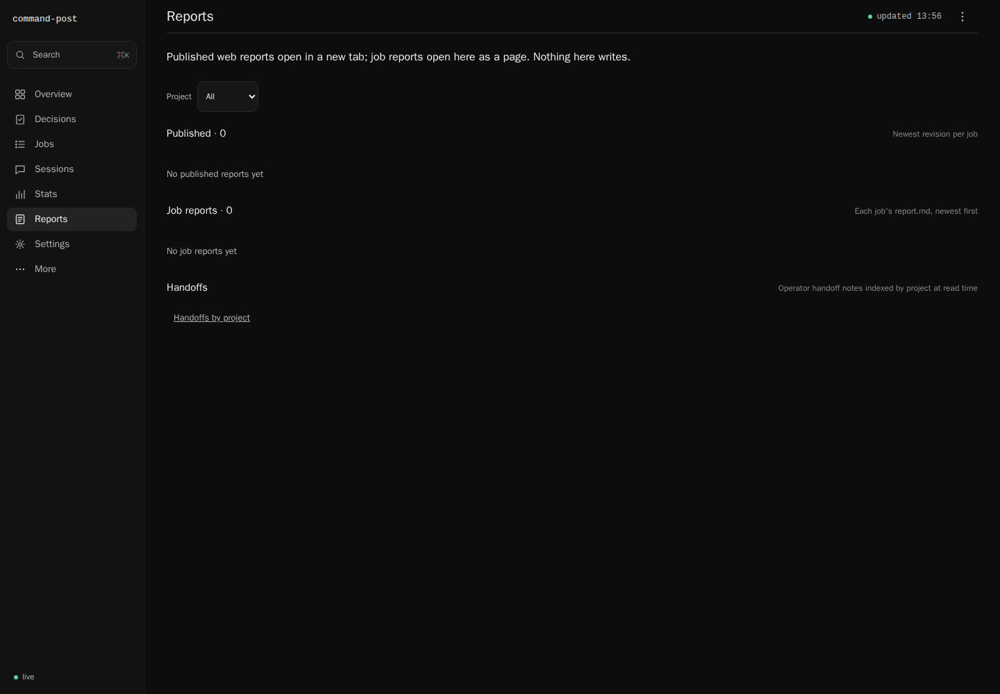 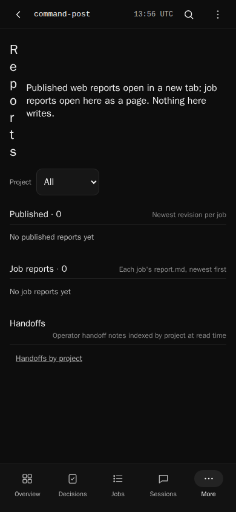

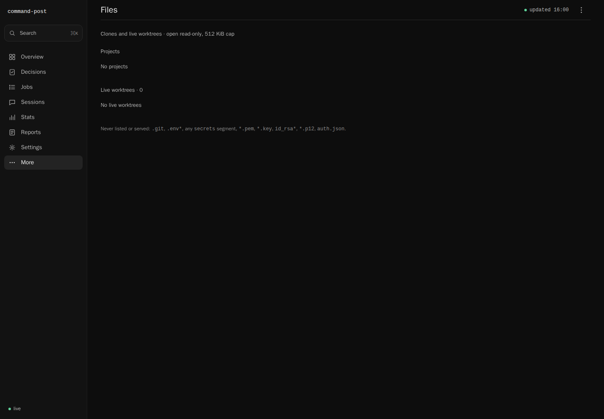 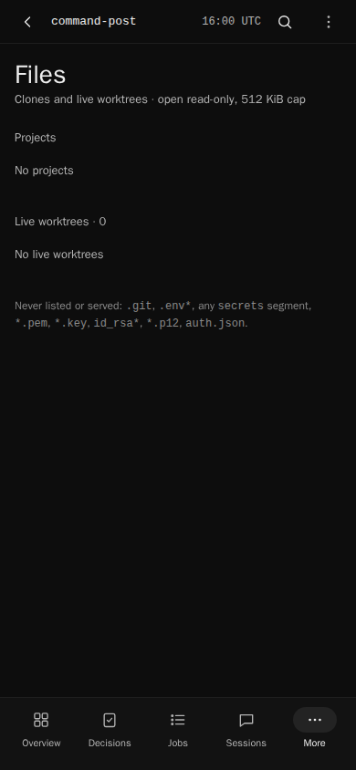

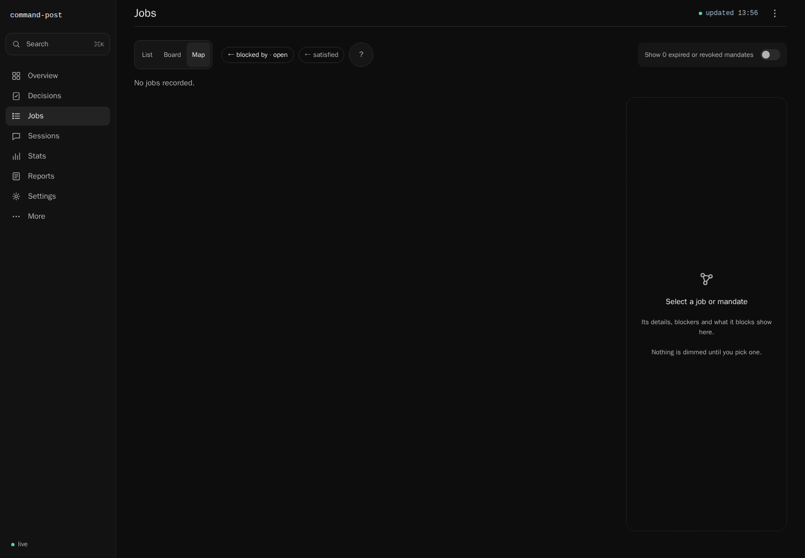 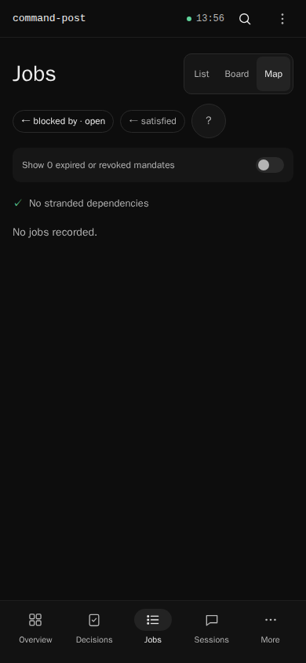
