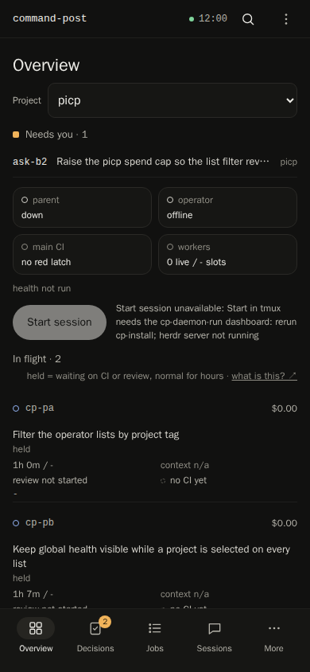
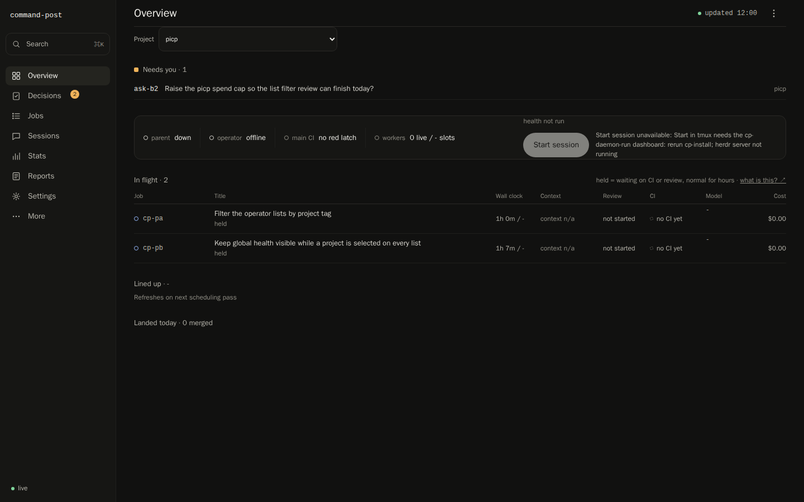
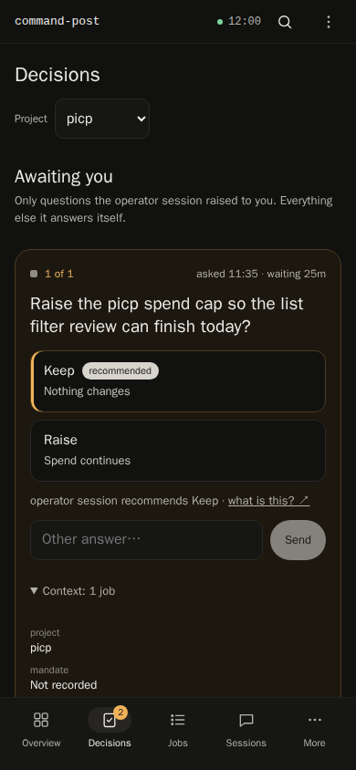
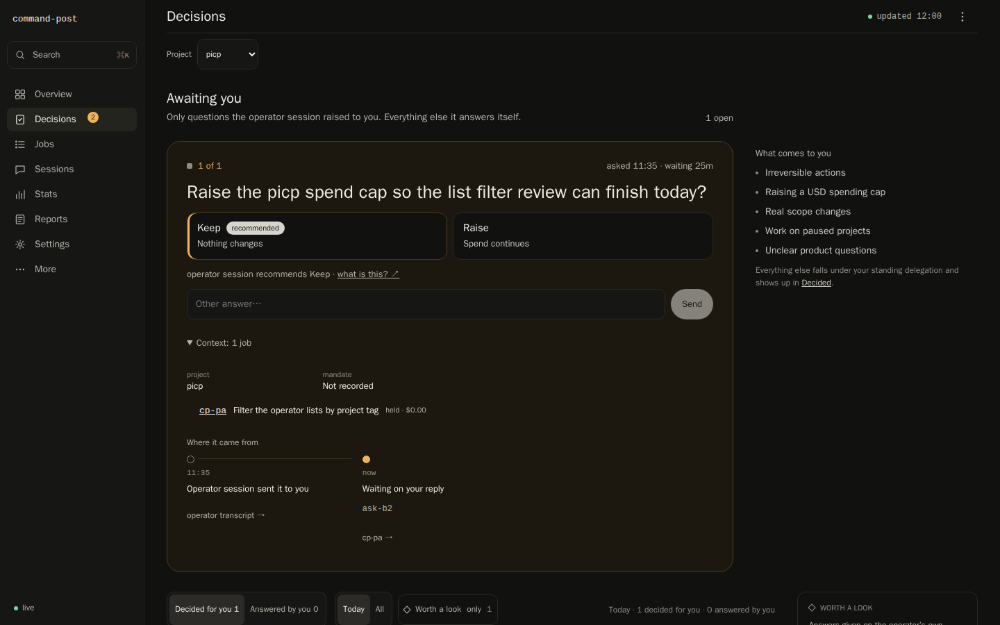
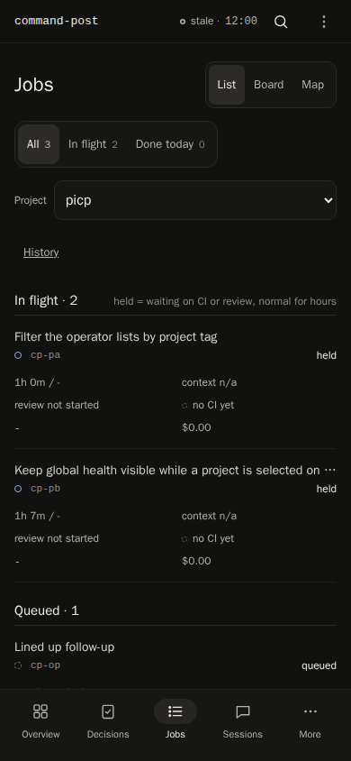
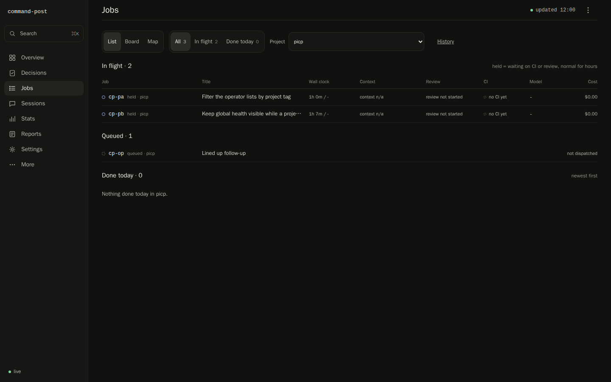
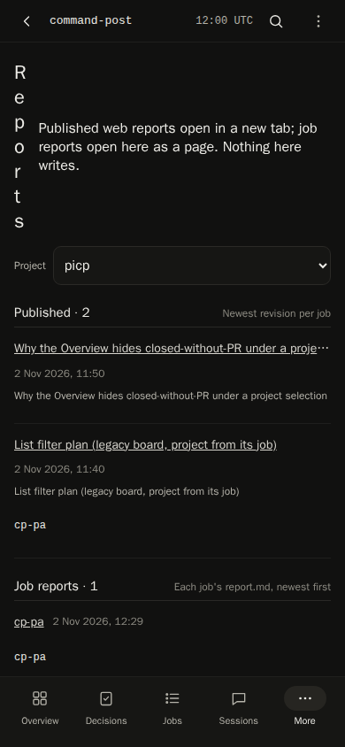
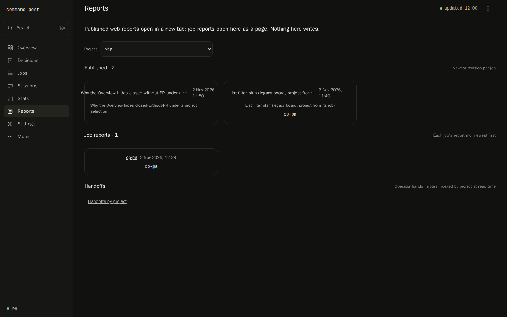

# Project filter on lists (M1 PR2) verification

The *Project* list filter (cp-m1-pr2-huyq) on Overview, Decisions, Jobs and Reports, served by a real `cp-view` in
headless Chrome (`--headless=new --screenshot`), at 390×844 and 1440×900, opened on `#<screen>?project=picp`.

## Fixture

A scratch home from `tests/harness/dashboard.ts` `dashboard()` (a `mktemp -d` directory the harness removes), with a
throwaway Chrome profile from `mktemp -d`, removed after each capture. No operational home, `~/.pi` or live viewer was
used, no agent ran and no credential was read. The capture script was a throwaway outside the repo and is not committed.

- Ledger and fleet: `picp` jobs `cp-pa`, `cp-pb` (a long title) and queued `cp-op`, `atlas` job `cp-at`, and `cp-lg` in
  a 52-character project.
- Boards: a jobless M2 board with `project: "picp"`, a legacy board resolved through `cp-pa`, a jobless `atlas` board
  and a legacy board in the long project; one job report for `cp-pa`.
- Asks: a long `picp` question and an `atlas` one; two delegated decisions today, one per project.

## Captures

## Observed

| Check | 390×844 | 1440×900 |
|---|---|---|
| Label and select | own row under the heading or phase tabs, select fills it | inline, capped at 320 px |
| Overview under `picp` | Needs you · 1 (`ask-b2` only), In flight · 2; health chips and the Decisions badge (2) global | same |
| Decisions under `picp` | `1 of 1` (`ask-b2`), Decided for you 1; badge 2 | same |
| Jobs under `picp` | `cp-pa`, `cp-pb`, `cp-op`; counts 3/2/0 | same |
| Reports under `picp` | jobless M2 board and the legacy `cp-pa` board; `cp-pa` job report | same |
| `atlas` and long-project rows | hidden | hidden |
