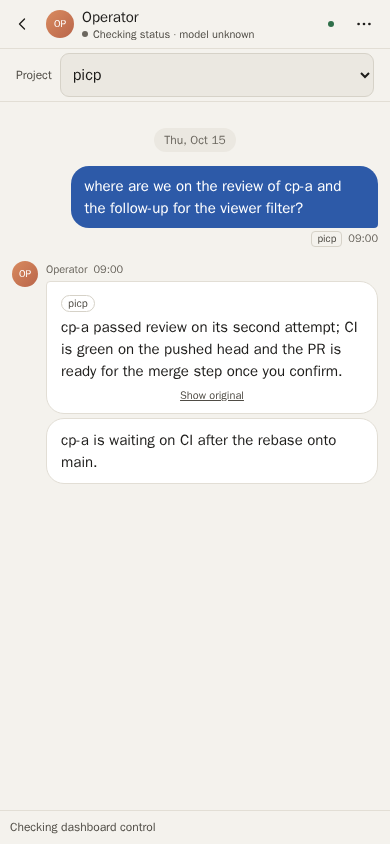
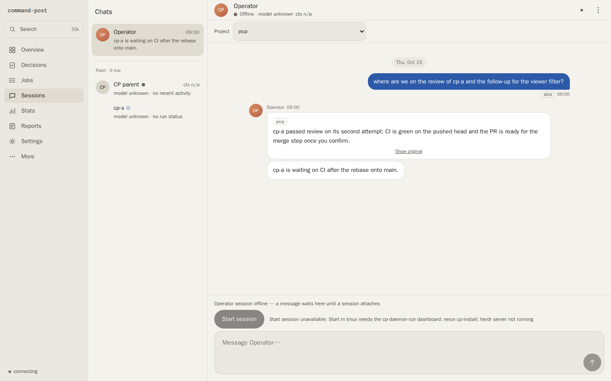

# Project filter on reply sections (M1 PR1) verification

The operator Full transcript's *Project* filter (cp-shrg), served by a real `cp-view` in headless Chrome
(`--headless=new --screenshot`), at 390×844 and 1440×900, opened on `#sessions?view=you&transcript=1&project=picp`.

## Fixture

A scratch home from `tests/harness/conversations.ts` `viewer()` (a `mktemp -d` directory the harness removes), with a
throwaway Chrome profile from `mktemp -d`, removed after the run. No operational home, `~/.pi` or live viewer was used,
no agent ran and no credential was read. The capture script was a throwaway outside the repo and is not committed.

- `projects/` holds `picp`, `atlas`, `demo-app` and a 52-character name; fleet job `cp-a` is in `picp`.
- One own message headed `[picp]`, one reply with a general preamble and `[picp]`, `[atlas]` and long-name sections,
  an untagged general note, and a reply naming `cp-a` (inferred `picp`).

## Captures

## Observed

| Check | 390×844 | 1440×900 |
|---|---|---|
| Label and select on one row | yes (label never wraps) | yes |
| Select width with the 52-character option | fills the row | capped at 320 px |
| Two-project reply under `picp` | only the `picp` section, *Show original* kept | same |
| Untagged note and other sections | hidden | hidden |
